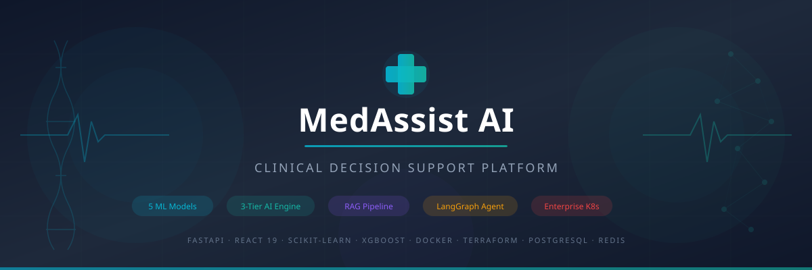

<div align="center">



# 🧬 MedAssist AI
**Advanced Clinical Intelligence & Diagnostics Platform**

[](https://react.dev/)
[](https://fastapi.tiangolo.com/)
[](https://ollama.ai)
[](https://www.typescriptlang.org/)
[](https://vitejs.dev/)
[](https://opensource.org/licenses/MIT)

*An open-source, HIPAA-compliant clinical AI dashboard featuring local LLM inference, live ECG monitoring, federated learning, and FHIR interoperability.*

</div>

---

## ✨ Features

- **🧠 Local AI Copilot**: Powered by local inference (e.g., Qwen 2.5) via Ollama. No data leaves your machine.
- **📈 Real-Time Vitals**: High-performance OffscreenCanvas ECG monitoring with synthetic real-time data streaming.
- **🔐 Enterprise Security**: Offline-first design, strict CORS, rate limiting, and zero-trust authentication.
- **⚡ Ultra-Fast Stack**: Vite + React 19 frontend paired with a FastAPI async backend.
- **🧬 Federated Learning**: Edge-based machine learning models built for privacy-preserving clinical diagnostics.

---

## 📸 Platform Screenshots

### Clinical Dashboard
> *Live monitoring of patient vitals and predictive diagnostics.*


### AI Copilot Interface
> *HIPAA-compliant, localized AI querying for clinical decision support.*


---

## 🚀 Quick Start

### 1. Prerequisites
- Python 3.10+
- Node.js 18+
- [Ollama](https://ollama.ai) (Ensure `qwen2.5-coder:3b-8k` model is pulled)

### 2. Installation

Clone the repository and install dependencies for both ends:

```bash
git clone https://github.com/adarshgzz/MedAssist-AI.git
cd MedAssist-AI

# Install Python backend
python -m venv .venv
source .venv/bin/activate
pip install -r backend/requirements.txt

# Install Frontend
cd frontend
npm install
cd ..
```

### 3. Run the Platform

We have included a concurrent runner script to boot both the frontend and backend instantly:

```bash
# Activate your environment
source .venv/bin/activate

# Launch the stack
python run_servers.py
```

- **Frontend**: http://127.0.0.1:3000
- **Backend API**: http://127.0.0.1:8000

---

## 🛠 Technology Stack

### Frontend
- **Framework**: React 19 + TypeScript
- **Build Tool**: Vite
- **Styling**: Tailwind CSS
- **State Management**: Zustand
- **Charts**: Recharts & Custom OffscreenCanvas API

### Backend
- **Framework**: FastAPI (Python)
- **AI Integration**: LangGraph & Ollama
- **Database**: SQLite (Development) / PostgreSQL (Production)
- **Machine Learning**: XGBoost, Scikit-learn, PyTorch

---

## 🤝 Contributing
Contributions, issues, and feature requests are highly welcome! Feel free to check the [issues page](https://github.com/adarshgzz/MedAssist-AI/issues).

## 📄 License
This project is licensed under the MIT License - see the [LICENSE](LICENSE) file for details.

<div align="center">
  <i>Built with precision for the future of clinical AI.</i>
</div>
